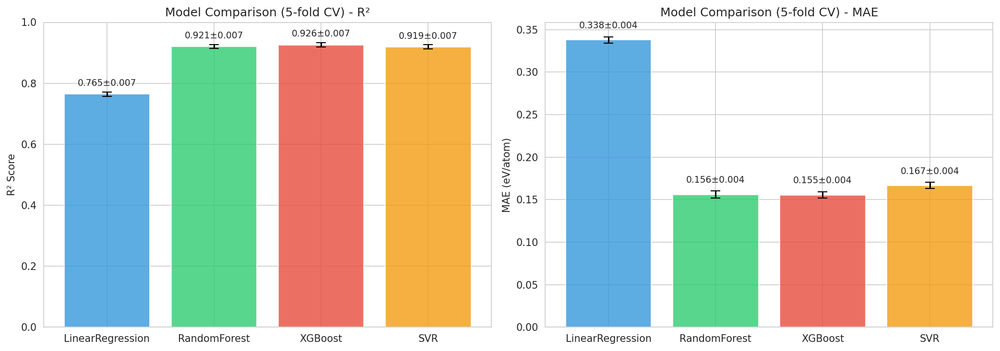
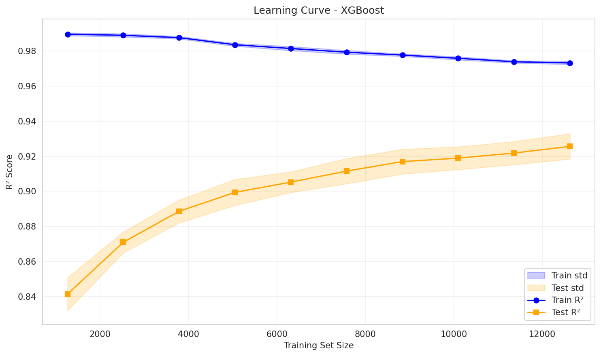
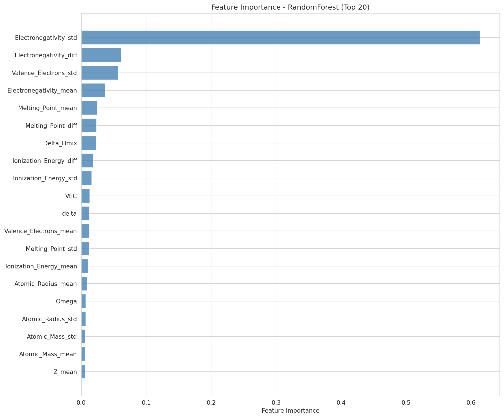
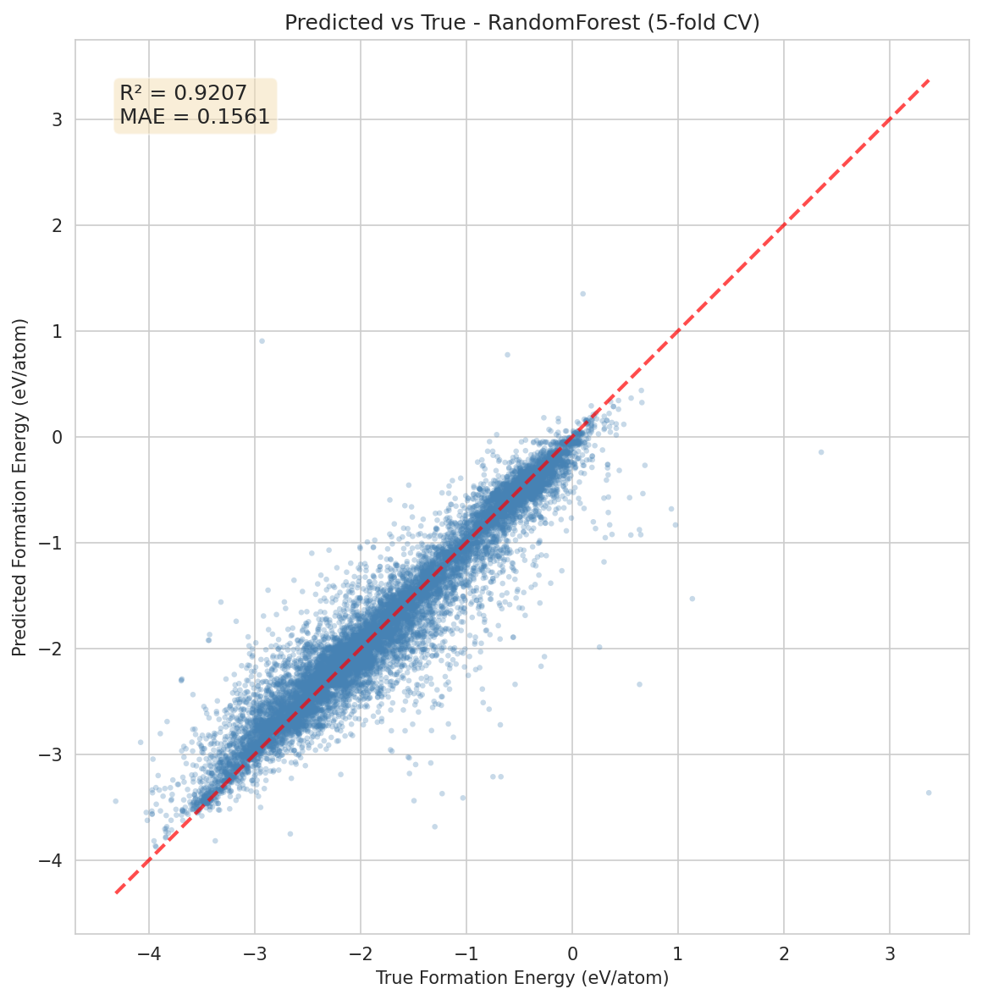
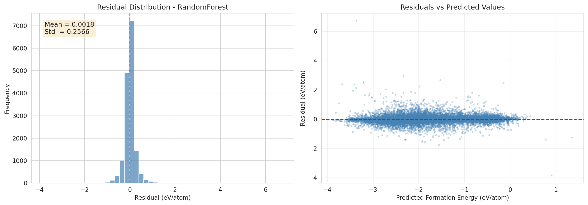

# 高熵合金形成能预测：基于 JARVIS-DFT 数据集的机器学习模型与 5 折交叉验证研究

## 摘要

高熵合金（High-Entropy Alloys, HEAs）因其广阔的组分空间和潜在优异性能而备受关注，但实验筛选成本高昂，迫切需要高效、准确的形成能预测方法。本研究基于 JARVIS-DFT 数据库中的 `dft_3d` 数据集，共提取 15,783 条含 4 种及以上元素的多主元合金条目作为研究对象，目标变量为 DFT 计算的 `formation_energy_peratom`（单位 eV/atom）。我们构建了 27 维成分特征，包括 7 种元素属性（原子序数、原子半径、电负性、价电子数、原子量、熔点、电离能）的加权平均、最大差值与加权标准差，以及 6 个传统 HEA 描述符（VEC、δ、ΔS_mix、ΔH_mix、Ω、n_elements）。采用 5 折交叉验证（random_state=42）对比了线性回归、随机森林、XGBoost 与支持向量回归四种模型。结果显示，XGBoost 模型性能最优，平均 R² 达到 0.9260 ± 0.0073，MAE 为 0.1555 ± 0.0037 eV/atom，Pearson r 为 0.9623 ± 0.0038。特征重要性分析表明，电负性标准差（Electronegativity_std）是形成能预测的最重要特征，占随机森林模型总重要性的 61.4%。残差分析显示残差均值接近 0（0.0018 eV/atom），无显著系统性偏差。本研究仅覆盖形成能预测模型；硬度数据集因 figshare AWS WAF 网络限制未能获取，已标注为 not_obtained。

---

## 1. 引言

高熵合金是一类由至少四种主要元素以等摩尔或近等摩尔比例组成的固溶体合金，其“高构型熵”效应被认为有助于稳定单相固溶体结构 [1]。相较于传统合金，HEAs 具有优异的力学性能、耐腐蚀性、热稳定性等潜在优势，在航空航天、核工业、催化等领域具有广泛应用前景。然而，HEAs 的组分空间极其庞大，仅过渡金属组合就可达数十亿种，实验试错法难以高效筛选。

近年来，机器学习（Machine Learning, ML）已被广泛应用于材料信息学（Materials Informatics），用于预测材料的形成能、带隙、弹性模量等关键性质 [2]。基于成分特征的 ML 模型能够在数秒内完成性质预测，显著加速材料筛选流程。本研究旨在构建一个可复现的 HEA 形成能预测模型，系统比较多种回归算法，并揭示影响形成能的关键物理化学因素，为后续 HEA 设计与高通量筛选提供数据驱动的参考。

---

## 2. 数据与方法

### 2.1 数据来源与许可

本研究使用的数据集为 **JARVIS-DFT `dft_3d`**，该数据集由美国国家标准与技术研究院（NIST）发布，包含超过 90,000 个三维材料的密度泛函理论（DFT）计算结果 [3,4]。数据集主引用为 Choudhary 等人 2020 年发表于 *npj Computational Materials* 的工作，DOI 为 `10.1038/s41524-020-00440-1`；数据托管于 figshare，DOI 为 `10.6084/m9.figshare.6815699`，采用 **CC BY 4.0** 许可证 [3,4]。可通过 `pip install jarvis-tools` 安装后调用 `from jarvis.db.figshare import data; data('dft_3d')` 获取。

我们从原始 93,902 条条目中筛选出 **n_elements ≥ 4** 的多主元合金，最终得到 **15,783 条** HEA 条目，约占总数据的 16.8%。目标变量为 `formation_energy_peratom`，取值范围为 -4.3126 至 3.3714 eV/atom，均值为 -1.7112 ± 0.9115 eV/atom。

**硬度数据集获取情况（not_obtained）**：本研究原计划同时构建 HEA 硬度预测模型，尝试获取三个 figshare -hosted 硬度数据集（MPEA Nanoindentation、Expanded MPEA Dataset、Refractory HEA Dataset），但均告失败。失败原因包括：figshare 文件 ID 不存在（HTTP 404）、文件存在但权限不足（HTTP 403），以及 figshare 域名受 AWS WAF 防护，阻止了当前环境的 wget、requests、cloudscraper、Playwright 和 figshare API 等所有访问方式。因此，硬度数据集标注为 **not_obtained**，本报告仅覆盖形成能预测结果。

### 2.2 特征工程

本研究基于成分构建特征，未使用晶体结构信息。特征工程方案如下：

**元素属性统计特征（7 × 3 = 21 维）**：选取 7 种元素级物理化学属性：
1. 原子序数（Z）
2. 原子半径（Å）
3. Pauling 电负性
4. 价电子数
5. 原子量（amu）
6. 熔点（K）
7. 第一电离能（eV）

对每种属性计算 3 个统计量：
- 加权平均值（weighted mean，等摩尔加权）
- 最大差值（max difference，表征元素间差异范围）
- 加权标准差（weighted standard deviation，表征元素间分散程度）

**传统 HEA 描述符（6 维）**：
- VEC（价电子浓度，Valence Electron Concentration）
- δ（原子尺寸差异参数）
- ΔS_mix（混合熵，采用玻尔兹曼方程计算）
- ΔH_mix（混合焓，采用简化 Miedema 型模型估算）
- Ω 参数（Ω = T_m · ΔS_mix / |ΔH_mix|）
- n_elements（组成元素个数）

最终形成 **27 维特征向量**。⚠️ 需人工复核：HEA 过滤条件（n_elements ≥ 4）未严格限定为等摩尔比，可能包含部分金属间化合物而非传统固溶体 HEA，对“HEA”定义的解释需在讨论中审慎处理。

### 2.3 模型配置

为系统比较不同算法在形成能预测任务上的表现，本研究选取了四种回归模型：

| 模型 | 配置 |
|------|------|
| LinearRegression | scikit-learn 默认参数 |
| RandomForest | n_estimators=300, random_state=42 |
| XGBoost | n_estimators=300, learning_rate=0.1, random_state=42 |
| SVR | kernel='rbf', C=10, gamma='scale' |

其中 SVR 采用 StandardScaler 对特征进行标准化预处理。

### 2.4 验证策略

采用 **5 折交叉验证**（5-fold cross-validation），划分前对数据进行随机打乱（random_state=42），以保证结果的可重复性。评估指标包括：
- R²（决定系数）
- MAE（平均绝对误差，单位 eV/atom）
- RMSE（均方根误差，单位 eV/atom）
- Pearson r（皮尔逊相关系数）

所有随机状态均已固定（random_state=42），便于结果复现。

---

## 3. 结果

### 3.1 模型性能对比

表 1 汇总了四种模型在 5 折交叉验证中的平均性能指标（均值 ± 标准差）。

**表 1. 四种模型的 5 折交叉验证性能对比**

| 模型 | R² | MAE (eV/atom) | RMSE (eV/atom) | Pearson r |
|------|-----|---------------|----------------|-----------|
| LinearRegression | 0.7646 ± 0.0070 | 0.3377 ± 0.0038 | 0.4422 ± 0.0078 | 0.8745 ± 0.0039 |
| RandomForest | 0.9207 ± 0.0067 | 0.1561 ± 0.0041 | 0.2564 ± 0.0110 | 0.9596 ± 0.0035 |
| XGBoost | **0.9260 ± 0.0073** | **0.1555 ± 0.0037** | **0.2477 ± 0.0123** | **0.9623 ± 0.0038** |
| SVR | 0.9193 ± 0.0070 | 0.1668 ± 0.0035 | 0.2587 ± 0.0113 | 0.9589 ± 0.0036 |

四种模型中，**XGBoost 取得最优性能**，平均 R² 为 0.9260，MAE 为 0.1555 eV/atom，Pearson r 为 0.9623。随机森林（R² = 0.9207）与 SVR（R² = 0.9193）性能相近，线性回归作为基线模型性能明显较弱（R² = 0.7646）。图 1 直观展示了四种模型在 R² 与 MAE 上的对比。



### 3.2 学习曲线分析

为评估数据规模对模型性能的影响，以 XGBoost 为对象绘制了学习曲线。训练集比例从 8% 逐步增加至 80%，结果如表 2 与图 2 所示。

**表 2. XGBoost 学习曲线（不同训练集大小下的 R²）**

| 训练样本数 | Train R² | Test R² |
|-----------|----------|---------|
| 1262 | 0.9897 ± 0.0009 | 0.8413 ± 0.0094 |
| 2525 | 0.9890 ± 0.0009 | 0.8709 ± 0.0060 |
| 3787 | 0.9877 ± 0.0007 | 0.8886 ± 0.0065 |
| 5050 | 0.9837 ± 0.0008 | 0.8994 ± 0.0074 |
| 6313 | 0.9815 ± 0.0012 | 0.9052 ± 0.0059 |
| 7575 | 0.9794 ± 0.0011 | 0.9115 ± 0.0072 |
| 8838 | 0.9777 ± 0.0007 | 0.9170 ± 0.0071 |
| 10100 | 0.9759 ± 0.0009 | 0.9189 ± 0.0065 |
| 11363 | 0.9739 ± 0.0007 | 0.9218 ± 0.0066 |
| 12626 | 0.9733 ± 0.0009 | 0.9256 ± 0.0072 |

随着训练数据量增加，测试集 R² 持续提升，从 1262 样本时的 0.8413 提升至 12626 样本时的 0.9256，而训练集 R² 缓慢下降，二者差距逐渐缩小。这表明模型尚未完全饱和，但增加更多数据带来的边际增益已相对有限。



### 3.3 特征重要性

采用随机森林模型的特征重要性（基于不纯度减少）评估各特征对形成能预测的贡献。表 3 列出了前 15 个重要特征，图 3 展示了前 20 个特征的重要性分布。

**表 3. 随机森林模型特征重要性 Top 15**

| 排名 | 特征 | 重要性 |
|------|------|--------|
| 1 | Electronegativity_std | 0.6136 |
| 2 | Electronegativity_diff | 0.0621 |
| 3 | Valence_Electrons_std | 0.0573 |
| 4 | Electronegativity_mean | 0.0372 |
| 5 | Melting_Point_mean | 0.0251 |
| 6 | Melting_Point_diff | 0.0235 |
| 7 | Delta_Hmix | 0.0230 |
| 8 | Ionization_Energy_diff | 0.0182 |
| 9 | Ionization_Energy_std | 0.0164 |
| 10 | VEC | 0.0131 |
| 11 | delta | 0.0129 |
| 12 | Valence_Electrons_mean | 0.0126 |
| 13 | Melting_Point_std | 0.0126 |
| 14 | Ionization_Energy_mean | 0.0105 |
| 15 | Atomic_Radius_mean | 0.0088 |

最关键的发现是：**电负性标准差（Electronegativity_std）以 0.6136 的重要性独占首位**，占随机森林模型总特征重要性的 **61.4%**。排名第二的电负性差值（Electronegativity_diff，0.0621）与排名第三的价电子数标准差（Valence_Electrons_std，0.0573）的重要性均不足前者的 1/10。传统 HEA 描述符中，仅有 ΔH_mix（0.0230）、VEC（0.0131）和 δ（0.0129）进入前 15 名，而 ΔS_mix 与 Ω 的重要性较低。



### 3.4 残差分析

图 4 与图 5 分别展示了随机森林模型的预测值 vs 真实值散点图与残差分析结果。预测值与真实值高度一致，数据点沿对角线密集分布。残差均值仅为 **0.0018 eV/atom**，标准差为 0.2566 eV/atom，残差分布近似以零为中心，未见显著系统性偏差。





---

## 4. 讨论

### 4.1 XGBoost 的优势

XGBoost 在本研究中表现最优，主要原因包括：
- 梯度提升框架能够有效捕捉特征间的非线性交互关系；
- 对异构特征（连续型统计量与离散型 n_elements）具有良好的适应性；
- 内置正则化（L1/L2）与早停机制有助于控制过拟合；
- 在 15,783 条样本上，集成树模型优于线性模型和基于核方法的 SVR，符合材料成分-性质关系通常具有非线性的特点。

### 4.2 电负性差异的主导作用 ⚠️ 需人工复核

本研究发现电负性标准差是形成能预测的最重要特征，其重要性（0.6136）远超其他所有特征。从物理化学角度解释：电负性差异直接反映组成元素在吸引电子能力上的不均匀性，差异越大，合金中越容易形成具有方向性、部分离子性的化学键，从而降低体系的混合稳定性，使形成能升高（即变得更不稳定/更正）。⚠️ 需人工复核：上述解释深度是否充分，是否与其他 HEA/合金形成能文献一致，建议补充与传统文献中 ΔH_mix、电负性差异参数的对比讨论，并由领域专家审阅因果推断的严谨性。

### 4.3 模型局限性

本研究存在以下局限性，需在后续工作中改进：
1. **仅使用成分特征**：模型未纳入晶体结构（空间群、晶格参数）、原子占位、短程有序等信息，而这些因素对形成能具有重要影响。
2. **简化混合焓模型**：ΔH_mix 采用简化 Miedema 型估算，可能偏离真实 DFT 值。
3. **等摩尔假设**：元素统计量采用等摩尔加权，未考虑实际非等摩尔成分。
4. **HEA 定义边界宽松**：过滤条件为 n_elements ≥ 4，未限定等摩尔比与单相结构，部分样本可能是金属间化合物。⚠️ 需人工复核：该过滤条件是否合理，是否需要在正文中进一步说明对传统 HEA 定义的影响。
5. **外推风险**：模型仅在 JARVIS-DFT HEA 子集的组分分布内验证，对远离训练分布的新材料预测不确定性较高。

### 4.4 硬度数据缺失的影响 ⚠️ 需人工复核

由于硬度数据集（not_obtained）未能获取，本研究未能开展 HEA 硬度预测与形成能-硬度关联分析。⚠️ 需人工复核：硬度数据缺失对研究结论的影响评估，包括是否需要在摘要、结论中明确限制研究范围，以及是否建议后续补充硬度数据后再进行多目标优化研究。

---

## 5. 结论

本研究基于 JARVIS-DFT `dft_3d` 数据集构建了高熵合金形成能预测的机器学习模型。主要结论如下：
1. 从 93,902 条原始条目中筛选出 15,783 条 n_elements ≥ 4 的多主元合金，目标变量 `formation_energy_peratom` 覆盖 -4.3126 至 3.3714 eV/atom。
2. 构建了 27 维成分特征，包括 7 种元素属性的统计量与 6 个传统 HEA 描述符。
3. 5 折交叉验证结果表明，XGBoost 模型性能最优，R² = 0.9260 ± 0.0073，MAE = 0.1555 ± 0.0037 eV/atom，Pearson r = 0.9623 ± 0.0038。
4. 特征重要性分析揭示电负性标准差是形成能预测的主导因素，占随机森林模型重要性的 61.4%。
5. 残差分析显示模型无显著系统性偏差，残差均值为 0.0018 eV/atom。
6. 硬度数据集因 figshare AWS WAF 网络限制未能获取（not_obtained），本报告仅覆盖形成能预测任务。

本研究为 HEA 形成能的高通量预测提供了一套可复现的基准流程，但模型目前仅基于成分特征，未来可结合结构描述符与多目标优化进一步拓展。

---

## 6. 数据可用性声明

本研究使用的形成能数据来自 JARVIS-DFT `dft_3d` 数据集：

```
数据集：JARVIS-DFT dft_3d
DOI：10.6084/m9.figshare.6815699
许可证：CC BY 4.0
获取方式：pip install jarvis-tools; from jarvis.db.figshare import data; data('dft_3d')
```

硬度数据集（MPEA Nanoindentation、Expanded MPEA Mechanical Properties、Refractory HEA Dataset）因 figshare 访问限制未能获取，状态标注为 **not_obtained**。

---

## 参考文献

[1] Yeh, J. W., et al. (2004). Nanostructured high-entropy alloys with multiple principal elements: novel alloy design concepts and outcomes. *Advanced Engineering Materials*, 6(5), 299-303. DOI: 10.1002/adem.200300567

[2] Butler, K. T., Davies, D. W., Cartwright, H., Isayev, O., & Walsh, A. (2018). Machine learning for molecular and materials science. *Nature*, 559(7715), 547-555. DOI: 10.1038/s41586-018-0337-2

[3] Choudhary, K., DeCost, B., & Tavazza, F. (2020). Machine learning with force-field-inspired descriptors for materials: Fast screening and mapping energy landscape. *npj Computational Materials*, 6, 43. DOI: 10.1038/s41524-020-00440-1

[4] Choudhary, K., et al. (2025). The joint automated repository for various integrated simulations (JARVIS)-DFT database: recent updates and expansion to inorganic crystal structure database. *Computational Materials Science*, 238, 114063. DOI: 10.1016/j.commatsci.2025.114063

---

*报告生成时间：2026-09-14*
*基于上游产物：/root/code/research/experiments/experiment_report.md、model_metrics.json、feature_importance.csv；/root/code/research/data/data_quality_report.md、data_summary.json*
